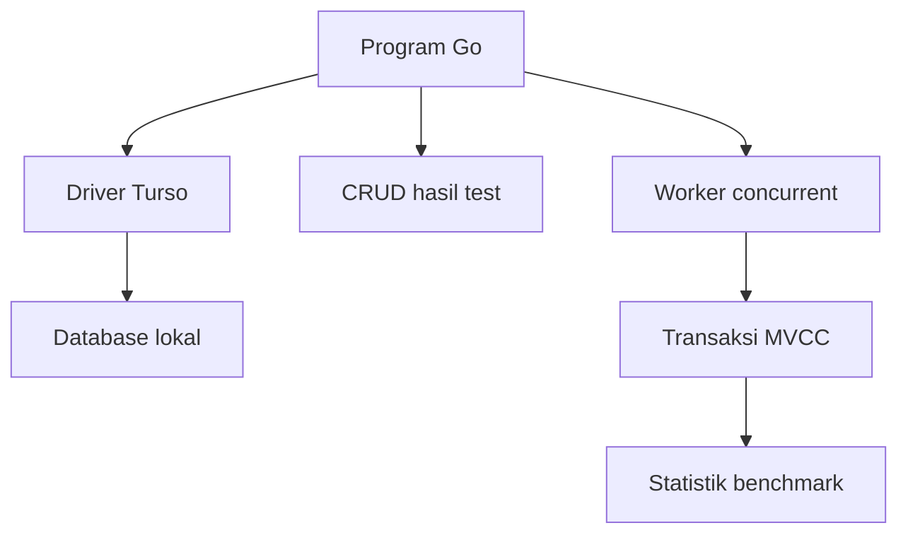

Berikut contoh **program Go lengkap menggunakan Turso Database lokal** untuk:

- Membuat database dan tabel otomatis.
- Menambahkan, membaca, memperbarui, dan menghapus data.
- Menjalankan banyak worker secara bersamaan.
- Menguji transaksi `BEGIN CONCURRENT` dengan MVCC.
- Melakukan retry ketika terjadi konflik transaksi.
- Mengukur throughput, waktu eksekusi, dan latency.
- Menguji data berdasarkan contoh hasil automation test.

> **Penting:** Contoh MVCC ini untuk pembelajaran dan benchmark. Dokumentasi Turso yang saya periksa masih menyebut MVCC belum siap untuk data production yang kritis. Gunakan database khusus pengujian dan lakukan backup terpisah sebelum mencoba pada data penting. [GitHub](https://github.com/tursodatabase/turso/blob/main/docs/manual.md?utm_source=chatgpt.com)

---

# 1. Cara kerja aplikasi



Contoh database menyimpan hasil eksekusi test:

| Kolom | Keterangan |
|---|---|
| `id` | ID hasil test |
| `run_id` | ID unik untuk satu benchmark |
| `test_suite` | Nama test suite |
| `scenario` | Nama scenario |
| `status` | Status test |
| `device` | Nama device |
| `exec_time_ms` | Durasi eksekusi simulasi dalam milidetik |
| `created_at` | Waktu pembuatan data |

---

# 2. Buat project

Jalankan:

```bash
mkdir turso-go-benchmark
```

```bash
cd turso-go-benchmark
```

Inisialisasi Go module:

```bash
go mod init turso-go-benchmark
```

Install driver Turso:

```bash
go get github.com/tursodatabase/turso-go@v0.2.0
```

Driver ini menggunakan `database/sql` dan membuka database lokal melalui `sql.Open("turso", path)`. [github.com](https://github.com/tursodatabase/turso/blob/main/README.md?utm_source=chatgpt.com)

---

# 3. Struktur project

```text
turso-go-benchmark/
├── data/
│   └── automation.db
├── go.mod
├── go.sum
└── main.go
```

Folder `data` dan file database akan dibuat oleh program saat pertama dijalankan.

---

# 4. Program lengkap

Buat file `main.go`:

```go
package main

import (
	"context"
	"database/sql"
	"flag"
	"fmt"
	"log"
	"math/rand"
	"os"
	"sort"
	"strings"
	"sync"
	"sync/atomic"
	"time"

	_ "github.com/tursodatabase/turso-go"
)

const schemaSQL = `
CREATE TABLE IF NOT EXISTS test_results (
	id INTEGER PRIMARY KEY,
	run_id TEXT NOT NULL,
	test_suite TEXT NOT NULL,
	scenario TEXT NOT NULL,
	status TEXT NOT NULL,
	device TEXT NOT NULL,
	exec_time_ms INTEGER NOT NULL,
	created_at TEXT NOT NULL
)
`

const indexSQL = `
CREATE INDEX IF NOT EXISTS idx_test_results_run_id
ON test_results(run_id)
`

const insertSQL = `
INSERT INTO test_results (
	run_id,
	test_suite,
	scenario,
	status,
	device,
	exec_time_ms,
	created_at
)
VALUES (?, ?, ?, ?, ?, ?, ?)
`

type TestResult struct {
	ID         int64
	RunID      string
	TestSuite  string
	Scenario   string
	Status     string
	Device     string
	ExecTimeMS int64
	CreatedAt  string
}

type BenchmarkStats struct {
	Successful atomic.Int64
	Failed     atomic.Int64
	Retries    atomic.Int64

	mu        sync.Mutex
	latencies []time.Duration
}

func (s *BenchmarkStats) addLatency(duration time.Duration) {
	s.mu.Lock()
	s.latencies = append(s.latencies, duration)
	s.mu.Unlock()
}

func main() {
	var (
		mode       string
		dbPath     string
		workers    int
		operations int
		maxRetries int
	)

	flag.StringVar(
		&mode,
		"mode",
		"crud",
		"Mode: crud atau benchmark",
	)

	flag.StringVar(
		&dbPath,
		"db",
		"data/automation.db",
		"Lokasi file database",
	)

	flag.IntVar(
		&workers,
		"workers",
		30,
		"Jumlah worker concurrent",
	)

	flag.IntVar(
		&operations,
		"operations",
		100,
		"Jumlah transaksi per worker",
	)

	flag.IntVar(
		&maxRetries,
		"retries",
		10,
		"Jumlah maksimum retry untuk transaksi konflik",
	)

	flag.Parse()

	if workers < 1 || operations < 1 || maxRetries < 0 {
		log.Fatal("workers dan operations harus > 0, retries harus >= 0")
	}

	if mode != "crud" && mode != "benchmark" {
		log.Fatalf("mode tidak dikenal: %s", mode)
	}

	if err := run(mode, dbPath, workers, operations, maxRetries); err != nil {
		log.Fatal(err)
	}
}

func run(
	mode string,
	dbPath string,
	workers int,
	operations int,
	maxRetries int,
) error {
	// Contoh ini memakai path default di folder data.
	// Jika memakai -db dengan folder lain, buat folder tersebut terlebih dahulu.
	if err := os.MkdirAll("data", 0755); err != nil {
		return fmt.Errorf("membuat folder data: %w", err)
	}

	db, err := sql.Open("turso", dbPath)
	if err != nil {
		return fmt.Errorf("membuka database: %w", err)
	}
	defer db.Close()

	// Dijalankan sebelum worker dan sebelum koneksi lain dibuat.
	// Jumlah koneksi akan diperbesar setelah setup selesai.
	db.SetMaxOpenConns(1)
	db.SetMaxIdleConns(1)

	ctx, cancel := context.WithTimeout(context.Background(), 30*time.Second)
	defer cancel()

	if err := db.PingContext(ctx); err != nil {
		return fmt.Errorf("ping database: %w", err)
	}

	// Gunakan MVCC hanya untuk benchmark ini.
	if mode == "benchmark" {
		var journalMode string

		err := db.QueryRowContext(
			ctx,
			"PRAGMA journal_mode = 'mvcc'",
		).Scan(&journalMode)
		if err != nil {
			return fmt.Errorf("mengaktifkan MVCC: %w", err)
		}

		if !strings.EqualFold(journalMode, "mvcc") {
			return fmt.Errorf(
				"MVCC tidak aktif, journal mode: %s",
				journalMode,
			)
		}

		fmt.Printf("Journal mode: %s\n", journalMode)
	}

	if _, err := db.ExecContext(ctx, schemaSQL); err != nil {
		return fmt.Errorf("membuat tabel: %w", err)
	}

	if _, err := db.ExecContext(ctx, indexSQL); err != nil {
		return fmt.Errorf("membuat index: %w", err)
	}

	fmt.Printf("Database: %s\n", dbPath)

	switch mode {
	case "crud":
		return runCRUD(ctx, db)

	case "benchmark":
		db.SetMaxOpenConns(workers)
		db.SetMaxIdleConns(workers)

		return runBenchmark(
			context.Background(),
			db,
			workers,
			operations,
			maxRetries,
		)
	}

	return nil
}

// ============================================================
// CRUD
// ============================================================

func runCRUD(ctx context.Context, db *sql.DB) error {
	runID := fmt.Sprintf("crud-%d", time.Now().UnixNano())

	result := TestResult{
		RunID:      runID,
		TestSuite:  "TS_P_Login",
		Scenario:   "Login_Using_Password",
		Status:     "PASSED",
		Device:     "iPhone 14",
		ExecTimeMS: 76000,
		CreatedAt:  time.Now().UTC().Format(time.RFC3339Nano),
	}

	// CREATE
	id, err := createResult(ctx, db, result)
	if err != nil {
		return fmt.Errorf("create: %w", err)
	}

	fmt.Printf("\nCREATE: data berhasil dibuat, ID=%d\n", id)

	// READ
	saved, err := getResult(ctx, db, id)
	if err != nil {
		return fmt.Errorf("read: %w", err)
	}

	printResult("READ", saved)

	// UPDATE
	if err := updateStatus(ctx, db, id, "FAILED"); err != nil {
		return fmt.Errorf("update: %w", err)
	}

	updated, err := getResult(ctx, db, id)
	if err != nil {
		return fmt.Errorf("read setelah update: %w", err)
	}

	printResult("UPDATE", updated)

	// DELETE
	if err := deleteResult(ctx, db, id); err != nil {
		return fmt.Errorf("delete: %w", err)
	}

	fmt.Printf("DELETE: data ID=%d berhasil dihapus\n", id)

	// Membuktikan bahwa data sudah tidak ditemukan.
	_, err = getResult(ctx, db, id)

	switch {
	case err == sql.ErrNoRows:
		fmt.Printf("VERIFY DELETE: data ID=%d tidak ditemukan\n", id)
	case err != nil:
		return fmt.Errorf("verifikasi delete: %w", err)
	default:
		return fmt.Errorf("verifikasi delete gagal: ID=%d masih ada", id)
	}

	return nil
}

func createResult(
	ctx context.Context,
	db *sql.DB,
	result TestResult,
) (int64, error) {
	res, err := db.ExecContext(
		ctx,
		insertSQL,
		result.RunID,
		result.TestSuite,
		result.Scenario,
		result.Status,
		result.Device,
		result.ExecTimeMS,
		result.CreatedAt,
	)
	if err != nil {
		return 0, err
	}

	return res.LastInsertId()
}

func getResult(
	ctx context.Context,
	db *sql.DB,
	id int64,
) (TestResult, error) {
	var result TestResult

	query := `
		SELECT
			id,
			run_id,
			test_suite,
			scenario,
			status,
			device,
			exec_time_ms,
			created_at
		FROM test_results
		WHERE id = ?
	`

	err := db.QueryRowContext(ctx, query, id).Scan(
		&result.ID,
		&result.RunID,
		&result.TestSuite,
		&result.Scenario,
		&result.Status,
		&result.Device,
		&result.ExecTimeMS,
		&result.CreatedAt,
	)

	return result, err
}

func updateStatus(
	ctx context.Context,
	db *sql.DB,
	id int64,
	status string,
) error {
	res, err := db.ExecContext(
		ctx,
		`UPDATE test_results SET status = ? WHERE id = ?`,
		status,
		id,
	)
	if err != nil {
		return err
	}

	affected, err := res.RowsAffected()
	if err != nil {
		return err
	}

	if affected == 0 {
		return sql.ErrNoRows
	}

	return nil
}

func deleteResult(
	ctx context.Context,
	db *sql.DB,
	id int64,
) error {
	res, err := db.ExecContext(
		ctx,
		`DELETE FROM test_results WHERE id = ?`,
		id,
	)
	if err != nil {
		return err
	}

	affected, err := res.RowsAffected()
	if err != nil {
		return err
	}

	if affected == 0 {
		return sql.ErrNoRows
	}

	return nil
}

func printResult(label string, result TestResult) {
	fmt.Printf(
		"%s: ID=%d | Suite=%s | Scenario=%s | Status=%s | Device=%s | Duration=%d ms\n",
		label,
		result.ID,
		result.TestSuite,
		result.Scenario,
		result.Status,
		result.Device,
		result.ExecTimeMS,
	)
}

// ============================================================
// CONCURRENT BENCHMARK
// ============================================================

func runBenchmark(
	ctx context.Context,
	db *sql.DB,
	workers int,
	operations int,
	maxRetries int,
) error {
	runID := fmt.Sprintf("benchmark-%d", time.Now().UnixNano())
	expected := workers * operations

	fmt.Println("\nMenjalankan benchmark...")
	fmt.Printf("Run ID              : %s\n", runID)
	fmt.Printf("Workers             : %d\n", workers)
	fmt.Printf("Operations / worker : %d\n", operations)
	fmt.Printf("Total operations    : %d\n", expected)
	fmt.Printf("Max retries         : %d\n", maxRetries)

	stats := &BenchmarkStats{
		latencies: make([]time.Duration, 0, expected),
	}

	start := time.Now()

	var wg sync.WaitGroup

	// Semua worker mulai dari titik yang kurang lebih sama.
	startSignal := make(chan struct{})

	for workerID := 1; workerID <= workers; workerID++ {
		wg.Add(1)

		go func(id int) {
			defer wg.Done()

			<-startSignal

			for operation := 1; operation <= operations; operation++ {
				result := TestResult{
					RunID:      runID,
					TestSuite:  "TS_P_Login",
					Scenario:   fmt.Sprintf("Login_Scenario_%d", operation),
					Status:     "PASSED",
					Device:     fmt.Sprintf("Device-%02d", id),
					ExecTimeMS: int64(1000 + operation),
					CreatedAt:  time.Now().UTC().Format(time.RFC3339Nano),
				}

				operationStart := time.Now()

				retryCount, err := insertConcurrent(
					ctx,
					db,
					result,
					maxRetries,
				)

				stats.Retries.Add(int64(retryCount))

				if err != nil {
					stats.Failed.Add(1)
					log.Printf(
						"worker=%d operation=%d error=%v",
						id,
						operation,
						err,
					)
					continue
				}

				stats.Successful.Add(1)
				stats.addLatency(time.Since(operationStart))
			}
		}(workerID)
	}

	close(startSignal)
	wg.Wait()

	elapsed := time.Since(start)

	count, err := countResultsByRunID(ctx, db, runID)
	if err != nil {
		return fmt.Errorf("menghitung hasil benchmark: %w", err)
	}

	printBenchmarkReport(stats, elapsed, expected, count)

	// Jumlah baris harus sama dengan jumlah transaksi yang dilaporkan sukses.
	if count != stats.Successful.Load() {
		return fmt.Errorf(
			"jumlah data tidak sesuai: database=%d, sukses=%d",
			count,
			stats.Successful.Load(),
		)
	}

	if stats.Failed.Load() > 0 {
		return fmt.Errorf(
			"benchmark selesai dengan %d operasi gagal",
			stats.Failed.Load(),
		)
	}

	return nil
}

func insertConcurrent(
	ctx context.Context,
	db *sql.DB,
	result TestResult,
	maxRetries int,
) (int, error) {
	var lastErr error

	for attempt := 0; attempt <= maxRetries; attempt++ {
		if err := ctx.Err(); err != nil {
			return attempt, err
		}

		// Penting: BEGIN, INSERT, COMMIT, dan ROLLBACK
		// harus menggunakan koneksi fisik yang sama.
		conn, err := db.Conn(ctx)
		if err != nil {
			return attempt, fmt.Errorf("mengambil koneksi: %w", err)
		}

		err = executeConcurrentTransaction(ctx, conn, result)

		// Jika rollback gagal, jangan kembalikan koneksi yang
		// status transaksinya tidak diketahui ke pool.
		closeErr := conn.Close()

		if err == nil && closeErr == nil {
			return attempt, nil
		}

		if err == nil {
			// COMMIT sudah berhasil. Jangan retry karena dapat
			// menghasilkan data duplikat.
			return attempt, fmt.Errorf(
				"transaksi berhasil tetapi koneksi gagal ditutup: %w",
				closeErr,
			)
		}

		lastErr = err

		if closeErr != nil {
			return attempt, fmt.Errorf(
				"transaksi gagal: %v; menutup koneksi: %w",
				err,
				closeErr,
			)
		}

		if !isRetryable(err) || attempt == maxRetries {
			return attempt, err
		}

		// Backoff pendek dan jitter untuk mengurangi tabrakan ulang.
		delay := retryDelay(attempt)

		timer := time.NewTimer(delay)

		select {
		case <-ctx.Done():
			timer.Stop()
			return attempt, ctx.Err()

		case <-timer.C:
		}
	}

	return maxRetries, lastErr
}

func executeConcurrentTransaction(
	ctx context.Context,
	conn *sql.Conn,
	result TestResult,
) error {
	if _, err := conn.ExecContext(ctx, "BEGIN CONCURRENT"); err != nil {
		return fmt.Errorf("begin concurrent: %w", err)
	}

	transactionOpen := true

	defer func() {
		if transactionOpen {
			// Context terpisah memungkinkan rollback walaupun
			// context operasi sudah dibatalkan.
			rollbackCtx, cancel := context.WithTimeout(
				context.Background(),
				5*time.Second,
			)
			defer cancel()

			if _, err := conn.ExecContext(
				rollbackCtx,
				"ROLLBACK",
			); err != nil {
				log.Printf("rollback gagal: %v", err)
			}
		}
	}()

	_, err := conn.ExecContext(
		ctx,
		insertSQL,
		result.RunID,
		result.TestSuite,
		result.Scenario,
		result.Status,
		result.Device,
		result.ExecTimeMS,
		result.CreatedAt,
	)
	if err != nil {
		return fmt.Errorf("insert: %w", err)
	}

	if _, err := conn.ExecContext(ctx, "COMMIT"); err != nil {
		return fmt.Errorf("commit: %w", err)
	}

	transactionOpen = false

	return nil
}

func isRetryable(err error) bool {
	message := strings.ToLower(err.Error())

	// Contoh sederhana mengikuti pola contoh resmi Turso.
	// Untuk production, gunakan kode error terstruktur dari
	// driver jika tersedia pada versi yang dipilih.
	return strings.Contains(message, "busy") ||
		strings.Contains(message, "conflict")
}

func retryDelay(attempt int) time.Duration {
	// Batas exponential backoff agar tidak terlalu panjang.
	if attempt > 6 {
		attempt = 6
	}

	base := time.Duration(1<<attempt) * time.Millisecond
	jitter := time.Duration(rand.Intn(5)) * time.Millisecond

	return base + jitter
}

func countResultsByRunID(
	ctx context.Context,
	db *sql.DB,
	runID string,
) (int64, error) {
	var count int64

	err := db.QueryRowContext(
		ctx,
		`SELECT COUNT(*) FROM test_results WHERE run_id = ?`,
		runID,
	).Scan(&count)

	return count, err
}

// ============================================================
// REPORT
// ============================================================

func printBenchmarkReport(
	stats *BenchmarkStats,
	elapsed time.Duration,
	expected int,
	databaseCount int64,
) {
	successful := stats.Successful.Load()
	failed := stats.Failed.Load()
	retries := stats.Retries.Load()

	stats.mu.Lock()
	latencies := append([]time.Duration(nil), stats.latencies...)
	stats.mu.Unlock()

	sort.Slice(latencies, func(i, j int) bool {
		return latencies[i] < latencies[j]
	})

	var totalLatency time.Duration

	for _, latency := range latencies {
		totalLatency += latency
	}

	var averageLatency time.Duration

	if len(latencies) > 0 {
		averageLatency = totalLatency / time.Duration(len(latencies))
	}

	throughput := float64(successful) / elapsed.Seconds()

	fmt.Println("\n================ BENCHMARK REPORT ================")
	fmt.Printf("Expected operations : %d\n", expected)
	fmt.Printf("Successful          : %d\n", successful)
	fmt.Printf("Failed              : %d\n", failed)
	fmt.Printf("Retries             : %d\n", retries)
	fmt.Printf("Rows in database    : %d\n", databaseCount)
	fmt.Printf("Elapsed time        : %s\n", elapsed)
	fmt.Printf("Throughput          : %.2f successful transactions/sec\n", throughput)
	fmt.Printf("Average latency     : %s\n", averageLatency)
	fmt.Printf("P50 latency         : %s\n", percentile(latencies, 50))
	fmt.Printf("P95 latency         : %s\n", percentile(latencies, 95))
	fmt.Printf("P99 latency         : %s\n", percentile(latencies, 99))
	fmt.Println("==================================================")
}

func percentile(
	sortedLatencies []time.Duration,
	percent int,
) time.Duration {
	if len(sortedLatencies) == 0 {
		return 0
	}

	// Nearest-rank percentile.
	index := (percent*len(sortedLatencies) + 99) / 100
	index--

	if index < 0 {
		index = 0
	}

	if index >= len(sortedLatencies) {
		index = len(sortedLatencies) - 1
	}

	return sortedLatencies[index]
}
```

---

# 5. Menjalankan contoh CRUD

```bash
go run . -mode crud
```

Program akan melakukan:

```text
CREATE → READ → UPDATE → READ → DELETE → VERIFY
```

Contoh output:

```text
Database: data/automation.db

CREATE: data berhasil dibuat, ID=1
READ: ID=1 | Suite=TS_P_Login | Scenario=Login_Using_Password | Status=PASSED | Device=iPhone 14 | Duration=76000 ms
UPDATE: ID=1 | Suite=TS_P_Login | Scenario=Login_Using_Password | Status=FAILED | Device=iPhone 14 | Duration=76000 ms
DELETE: data ID=1 berhasil dihapus
VERIFY DELETE: data ID=1 tidak ditemukan
```

ID dan hasil aktual dapat berbeda.

---

# 6. Menjalankan benchmark concurrent

Contoh untuk **30 worker**, masing-masing melakukan **100 transaksi**:

```bash
go run . \
  -mode benchmark \
  -db data/benchmark.db \
  -workers 30 \
  -operations 100 \
  -retries 10
```

Total operasi:

```text
30 workers × 100 operations = 3.000 transaksi
```

Setiap transaksi melakukan satu `INSERT`.

Contoh tambahan:

```bash
go run . \
  -mode benchmark \
  -db data/benchmark-10.db \
  -workers 10 \
  -operations 1000 \
  -retries 10
```

```bash
go run . \
  -mode benchmark \
  -db data/benchmark-50.db \
  -workers 50 \
  -operations 500 \
  -retries 15
```

Gunakan file database yang berbeda untuk setiap skenario agar ukuran database dari benchmark sebelumnya tidak memengaruhi hasil secara tidak sengaja.

---

# 7. Contoh hasil benchmark

**Angka berikut hanya ilustrasi, bukan hasil pengujian aktual.**

```text
Journal mode: mvcc
Database: data/benchmark.db

Menjalankan benchmark...
Run ID              : benchmark-1760000000000000000
Workers             : 30
Operations / worker : 100
Total operations    : 3000
Max retries         : 10

================ BENCHMARK REPORT ================
Expected operations : 3000
Successful          : 3000
Failed              : 0
Retries             : 20
Rows in database    : 3000
Elapsed time        : 2.5s
Throughput          : 1200.00 successful transactions/sec
Average latency     : 20ms
P50 latency         : 15ms
P95 latency         : 45ms
P99 latency         : 80ms
==================================================
```

### Arti metrik

| Metrik | Penjelasan |
|---|---|
| `Successful` | Jumlah transaksi yang berhasil dilaporkan program. |
| `Failed` | Jumlah operasi yang gagal setelah retry atau gagal karena error lain. |
| `Retries` | Total percobaan ulang akibat konflik atau database busy. |
| `Rows in database` | Jumlah baris untuk `run_id` benchmark tersebut. |
| `Elapsed time` | Total waktu benchmark, termasuk proses worker. |
| `Throughput` | Jumlah transaksi sukses dibagi total waktu. |
| `Average latency` | Rata-rata waktu operasi sukses, termasuk retry dan waktu menunggu koneksi. |
| `P50` | Sekitar 50% operasi sukses selesai dalam waktu tersebut atau lebih cepat. |
| `P95` | Sekitar 95% operasi sukses selesai dalam waktu tersebut atau lebih cepat. |
| `P99` | Sekitar 99% operasi sukses selesai dalam waktu tersebut atau lebih cepat. |

**Latency operasi yang gagal tidak dimasukkan ke percentile**, jadi selalu lihat jumlah `Failed` bersamaan dengan latency dan throughput.

---

# 8. Query yang digunakan

## A. Membuat tabel

```sql
CREATE TABLE IF NOT EXISTS test_results (
    id INTEGER PRIMARY KEY,
    run_id TEXT NOT NULL,
    test_suite TEXT NOT NULL,
    scenario TEXT NOT NULL,
    status TEXT NOT NULL,
    device TEXT NOT NULL,
    exec_time_ms INTEGER NOT NULL,
    created_at TEXT NOT NULL
);
```

## B. Membuat index

```sql
CREATE INDEX IF NOT EXISTS idx_test_results_run_id
ON test_results(run_id);
```

Index membantu pencarian berdasarkan `run_id`, tetapi juga menambah pekerjaan saat `INSERT`. Karena itu, hasil benchmark mencakup biaya pemeliharaan index.

## C. Insert

```sql
INSERT INTO test_results (
    run_id,
    test_suite,
    scenario,
    status,
    device,
    exec_time_ms,
    created_at
)
VALUES (?, ?, ?, ?, ?, ?, ?);
```

Placeholder `?` diisi menggunakan parameter Go.

## D. Select berdasarkan ID

```sql
SELECT
    id,
    run_id,
    test_suite,
    scenario,
    status,
    device,
    exec_time_ms,
    created_at
FROM test_results
WHERE id = ?;
```

## E. Update status

```sql
UPDATE test_results
SET status = ?
WHERE id = ?;
```

## F. Delete

```sql
DELETE FROM test_results
WHERE id = ?;
```

## G. Menghitung hasil per benchmark

```sql
SELECT COUNT(*)
FROM test_results
WHERE run_id = ?;
```

## H. Mengelompokkan status

```sql
SELECT
    status,
    COUNT(*) AS total
FROM test_results
GROUP BY status
ORDER BY total DESC;
```

## I. Menghitung hasil per device

```sql
SELECT
    device,
    COUNT(*) AS total
FROM test_results
GROUP BY device
ORDER BY device;
```

## J. Rata-rata waktu eksekusi per device

```sql
SELECT
    device,
    COUNT(*) AS total_test,
    AVG(exec_time_ms) AS average_exec_time_ms
FROM test_results
GROUP BY device
ORDER BY device;
```

## K. Melihat hasil test terbaru

```sql
SELECT
    id,
    test_suite,
    scenario,
    status,
    device,
    exec_time_ms,
    created_at
FROM test_results
ORDER BY id DESC
LIMIT 20;
```

## L. Melihat test yang gagal

```sql
SELECT
    id,
    test_suite,
    scenario,
    device,
    created_at
FROM test_results
WHERE status = 'FAILED'
ORDER BY id DESC;
```

---

# 9. Cara kerja `BEGIN CONCURRENT`

Pada contoh, program mengaktifkan MVCC:

```sql
PRAGMA journal_mode = 'mvcc';
```

Kemudian setiap worker menjalankan transaksi:

```sql
BEGIN CONCURRENT;

INSERT INTO test_results (...);

COMMIT;
```

Jika terjadi konflik:

```sql
ROLLBACK;
```

Kemudian program mencoba mengulang seluruh transaksi.

Untuk menjalankan transaksi secara concurrent, setiap transaksi harus menggunakan **koneksi yang berbeda**. Di Go, contoh menggunakan `db.Conn(ctx)` agar `BEGIN`, `INSERT`, `COMMIT`, dan `ROLLBACK` tetap berada pada koneksi yang sama. [GitHub](https://github.com/tursodatabase/turso/blob/main/docs/manual.md?utm_source=chatgpt.com)

### Kenapa perlu retry?

MVCC memakai pendekatan optimistic concurrency. Jika dua transaksi mengubah data yang saling bertabrakan, salah satunya dapat menerima error seperti `SQLITE_BUSY` atau conflict. Transaksi yang gagal perlu di-rollback dan dapat dicoba kembali.

Contoh resmi Turso juga menggunakan pemeriksaan error `busy` atau `conflict` dan retry. Untuk production, lebih baik memeriksa **kode error terstruktur** jika driver versi yang digunakan menyediakannya, bukan hanya mencocokkan teks error. [GitHub](https://github.com/tursodatabase/turso/blob/main/docs/manual.md?utm_source=chatgpt.com)

> Contoh di atas mengilustrasikan mekanismenya, tetapi **belum cukup aman untuk production**: jika `ROLLBACK` gagal, program hanya mencatat error dan tidak menjamin koneksi yang statusnya tidak diketahui dibuang dari pool. Selain itu, kegagalan saat `COMMIT` dapat memiliki hasil yang tidak pasti. Untuk sistem nyata, gunakan desain idempotensi dengan ID operasi unik dan pastikan perilaku error serta pembuangan koneksi diuji pada versi driver yang dipakai.

---

# 10. Build untuk pengujian performa

Untuk benchmark, lebih baik build terlebih dahulu agar waktu kompilasi Go tidak ikut tercampur dengan proses menjalankan aplikasi:

```bash
go build -o turso-benchmark .
```

Jalankan:

```bash
./turso-benchmark \
  -mode benchmark \
  -db data/performance.db \
  -workers 30 \
  -operations 1000 \
  -retries 10
```

Contoh ini menguji:

```text
30 × 1.000 = 30.000 transaksi
```

Catat hasil untuk beberapa konfigurasi:

| Skenario | Workers | Operasi per worker | Total transaksi |
|---|---:|---:|---:|
| Single worker | 1 | 1.000 | 1.000 |
| Kecil | 5 | 1.000 | 5.000 |
| Device farm | 30 | 1.000 | 30.000 |
| Beban tinggi | 50 | 1.000 | 50.000 |

Untuk membandingkan **Turso dengan SQLite**, gunakan jumlah transaksi, schema, index, ukuran database awal, konfigurasi durability, dan perangkat yang sama. Jalankan beberapa kali dan bandingkan juga kegagalan, retry, serta P95/P99—jangan hanya melihat transaksi per detik.

**Batas contoh ini:** benchmark hanya menguji operasi `INSERT` sederhana. Ia belum menguji campuran read/write, update pada baris yang sama, transaksi multi-query, penggunaan RAM, atau recovery setelah aplikasi dihentikan mendadak. Saya belum menjalankan kode ini di lingkungan Reza, jadi hasil dan kompatibilitas driver tetap perlu diverifikasi pada mesin serta versi dependency yang digunakan.


structure code 

```text
my-app/
├── cmd/
│   └── server/
│       └── main.go
├── internal/
│   ├── config/
│   │   └── config.go
│   ├── handler/
│   │   └── user_handler.go
│   ├── service/
│   │   └── user_service.go
│   ├── repository/
│   │   └── user_repository.go
│   ├── model/
│   │   └── user.go
│   └── database/
│       └── postgres.go
├── migrations/
│   └── 001_create_users.sql
├── docs/
│   ├── architecture.md
│   ├── api.md
│   └── setup.md
├── skills/
│   └── example-skill/
│       └── SKILL.md
├── media/
│   ├── images/
│   ├── videos/
│   └── documents/
├── Production/
│   ├── my-app
│   └── .env
├── .env.example
├── .gitignore
├── go.mod
├── go.sum
├── Makefile
└── README.md
```

Untuk membuat folder, menyalin contoh konfigurasi, dan melakukan build:

```bash
mkdir -p Production
cp -n .env.example Production/.env
go build -o Production/my-app ./cmd/server
```

`cp -n` menjaga agar `Production/.env` yang sudah ada tidak tertimpa. Sesuaikan nilai di file tersebut sebelum menjalankan aplikasi:

```bash
cd Production
./my-app
```

Aplikasi perlu dikonfigurasi untuk membaca `.env`; Go tidak memuatnya secara otomatis.

Tambahkan folder production ke `.gitignore`:

```gitignore
/Production/
```
Makefile Commands
Perintah	Deskripsi
make start	Melakukan build ke folder Production, lalu menjalankan aplikasi.
make run	Menjalankan aplikasi langsung dalam mode development tanpa proses build.
make stop	Menghentikan proses aplikasi yang sedang berjalan.
make build	Melakukan build dan menyimpan hasilnya ke folder Production.