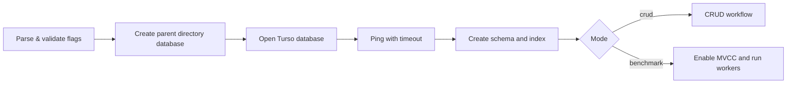

# Rencana Teknis — Go Turso Local CRUD & Concurrent Benchmark

## 1. Tujuan

Membangun aplikasi Go yang menggunakan Turso database lokal untuk dua kebutuhan yang terpisah tetapi berbagi schema:

1. **Mode CRUD** — memverifikasi create, read, update, delete, dan delete verification untuk data hasil automation test.
2. **Mode benchmark** — mengukur kemampuan `INSERT` concurrent dengan mode MVCC (`BEGIN CONCURRENT`), retry konflik, dan metrik latency/throughput.

Aplikasi ini adalah alat pengujian lokal, **bukan** desain database production. Dukungan MVCC dan perilaku error harus divalidasi pada versi Turso driver yang dipakai.

## 2. Keputusan Arsitektur

| Area | Keputusan |
|---|---|
| Bahasa/runtime | Go, versi ditetapkan pada `go.mod` dan CI. |
| Database | Turso lokal melalui `database/sql` dan driver `turso.tech/database/tursogo`. |
| Bentuk aplikasi | CLI, bukan HTTP server. Struktur `cmd` + `internal` agar kode benchmark tetap testable. |
| Mode operasi | `crud` dan `benchmark`. |
| Concurrency | Satu goroutine per worker; satu koneksi fisik per transaksi concurrent. |
| Transaksi benchmark | `BEGIN CONCURRENT` → `INSERT` → `COMMIT`; rollback best-effort saat transaksi gagal. |
| Retry | Hanya untuk error yang diklasifikasikan retryable; exponential backoff dengan jitter dan batas retry. |
| Data | Satu `run_id` unik per eksekusi agar hasil benchmark dapat dihitung dan diisolasi. |
| Konfigurasi | CLI flags; environment file tidak dibutuhkan untuk aplikasi lokal ini. |

> Struktur `postgres.go` dari contoh lama tidak digunakan karena targetnya adalah Turso, bukan PostgreSQL.

## 3. Scope

### In scope
- Inisialisasi database lokal dan schema `test_results`.
- CRUD satu record hasil test.
- Benchmark concurrent insert berbasis MVCC.
- Pelaporan jumlah sukses/gagal/retry, throughput, average latency, P50/P95/P99.
- Unit test untuk validasi input, percentile, retry/backoff, dan SQL helper.
- Smoke test CRUD serta benchmark kecil pada dependency/driver yang dipin.

### Out of scope
- Turso cloud, replication, authentication, HTTP API, UI, dan multi-tenant.
- Migrasi production dan SLA production.
- Benchmark read/write campuran, recovery crash, atau profiling memori mendalam.

## 4. Struktur Target

```text
.
├── cmd/
│   └── turso-benchmark/
│       └── main.go                 # parsing flag dan exit code
├── internal/
│   ├── app/
│   │   └── run.go                  # orkestrasi mode CRUD/benchmark
│   ├── benchmark/
│   │   ├── runner.go               # worker dan koordinasi start
│   │   ├── transaction.go          # BEGIN CONCURRENT/COMMIT/ROLLBACK
│   │   ├── retry.go                # klasifikasi error dan backoff
│   │   └── report.go               # statistik dan percentile
│   ├── database/
│   │   └── turso.go                # open, ping, schema, pragma MVCC
│   ├── result/
│   │   ├── model.go
│   │   └── repository.go           # CRUD dan count by run ID
│   └── config/
│       └── config.go               # validasi flag dan default
├── migrations/
│   └── 001_create_test_results.sql
├── Docs/
│   ├── Readme.md                   # materi/contoh awal
│   └── Technical-Plan.md
├── data/                            # generated, di-ignore git
├── Makefile
├── go.mod
├── go.sum
├── .gitignore
└── README.md
```

## 5. Desain Data

### Tabel

```sql
CREATE TABLE IF NOT EXISTS test_results (
    id INTEGER PRIMARY KEY,
    run_id TEXT NOT NULL,
    test_suite TEXT NOT NULL,
    scenario TEXT NOT NULL,
    status TEXT NOT NULL,
    device TEXT NOT NULL,
    exec_time_ms INTEGER NOT NULL,
    created_at TEXT NOT NULL
);

CREATE INDEX IF NOT EXISTS idx_test_results_run_id
ON test_results(run_id);
```

### Kontrak data

| Kolom | Aturan |
|---|---|
| `id` | Primary key yang dibuat database. |
| `run_id` | Wajib, unik per eksekusi aplikasi. Digunakan untuk isolasi hasil benchmark. |
| `test_suite`, `scenario`, `device` | Wajib dan tidak kosong. |
| `status` | Wajib; fase awal menerima `PASSED` atau `FAILED`. |
| `exec_time_ms` | Wajib, bilangan bulat `>= 0`. |
| `created_at` | Wajib, UTC RFC3339Nano. |

Untuk production, tambahkan `operation_id TEXT UNIQUE` bila operasi perlu idempotent. Ini mencegah insert ganda ketika hasil `COMMIT` tidak dapat dipastikan.

## 6. Kontrak CLI

```text
-mode        crud | benchmark          default: crud
-db          lokasi file database      default: data/automation.db
-workers     jumlah worker             default: 30
-operations  transaksi per worker      default: 100
-retries     retry maksimum            default: 10
-timeout     timeout seluruh run       default: 30s
```

Validasi:
- `mode` harus `crud` atau `benchmark`.
- `workers` dan `operations` harus lebih dari nol.
- `retries` harus nol atau lebih.
- Parent directory dari `-db` harus dibuat dari nilai flag tersebut, bukan selalu folder `data`.
- Nilai `workers * operations` harus diperiksa terhadap overflow dan batas praktis yang ditetapkan aplikasi.

Exit code `0` berarti seluruh verifikasi berhasil; exit code non-nol berarti setup, operasi, atau validasi benchmark gagal.

## 7. Alur Eksekusi

### Setup bersama



### CRUD

1. Buat `run_id` dan satu `TestResult` valid.
2. Insert record, ambil ID.
3. Baca record dan validasi seluruh field penting.
4. Update status menjadi `FAILED`, baca ulang dan validasi.
5. Hapus record.
6. Pastikan `SELECT` menghasilkan `sql.ErrNoRows`.

### Benchmark

1. Set `PRAGMA journal_mode = 'mvcc'` dan pastikan responsnya `mvcc`.
2. Naikkan pool koneksi maksimal hingga jumlah worker bila driver mendukungnya.
3. Buat `run_id`, stats thread-safe, `WaitGroup`, dan start barrier.
4. Setiap worker menjalankan jumlah operasi yang sama.
5. Setiap operasi mengambil `*sql.Conn` agar `BEGIN`, `INSERT`, `COMMIT`, dan `ROLLBACK` menggunakan koneksi fisik yang identik.
6. Catat latency **hanya jika transaksi sukses**; catat gagal dan retry terpisah.
7. Setelah seluruh worker selesai, hitung row berdasarkan `run_id`.
8. Lulus hanya bila `databaseCount == successful` dan `failed == 0`.

## 8. Strategi Transaksi dan Retry

### Pseudocode

```text
for attempt = 0..maxRetries:
    acquire dedicated connection
    BEGIN CONCURRENT
    INSERT result
    COMMIT
    if success: close connection; return success

    attempt ROLLBACK using independent short-lived context
    discard/avoid reusing connection when transaction state is uncertain
    if error is not retryable or retry limit reached: return error
    wait exponential-backoff + jitter, unless context cancelled
```

### Aturan penting

- Jangan memakai `db.Exec` terpisah untuk statement transaksi karena pool dapat memilih koneksi berbeda.
- Jangan retry setelah `COMMIT` sukses, bahkan bila penutupan koneksi gagal; retry dapat menduplikasi data.
- Jika rollback gagal, koneksi tidak boleh dianggap aman untuk digunakan kembali. Implementasi harus mengikuti mekanisme discard/close yang didukung driver dan diverifikasi lewat test integrasi.
- Pencocokan string `busy`/`conflict` hanyalah fallback benchmark. Jika driver mengekspos kode error terstruktur, gunakan kode tersebut.
- Gunakan `math/rand/v2` atau random source yang aman/terisolasi sesuai versi Go yang dipin untuk jitter.

## 9. Metrik Benchmark

| Metrik | Rumus / aturan |
|---|---|
| Expected | `workers × operations` |
| Successful | operasi dengan commit sukses |
| Failed | operasi yang habis retry atau non-retryable error |
| Retries | total retry yang benar-benar dijalankan |
| Rows | `COUNT(*)` berdasarkan `run_id` |
| Elapsed | dari worker dilepas hingga seluruh worker selesai |
| Throughput | `successful / elapsed.Seconds()` |
| Average latency | total latency sukses / jumlah sukses |
| P50/P95/P99 | nearest-rank dari latency sukses yang telah diurutkan |

Laporan harus selalu menunjukkan `Failed` bersama percentile agar angka latency tidak disalahartikan. Hasil antar-run hanya boleh dibandingkan jika mesin, versi Go/driver, schema/index, ukuran database awal, flags, dan konfigurasi durability sama.

## 10. Rencana Implementasi

| Fase | Deliverable | Kriteria selesai |
|---|---|---|
| 0. Bootstrap | `go.mod`, `.gitignore`, Makefile, struktur folder | `go test ./...` dapat berjalan. |
| 1. Database & model | migrasi, open/ping, model, repository | CRUD unit/integrasi lulus. |
| 2. CLI & CRUD | flags, validasi, mode CRUD | command CRUD selesai dengan exit code 0. |
| 3. Benchmark inti | worker, dedicated connection, MVCC transaction | benchmark kecil menulis jumlah row yang konsisten. |
| 4. Retry & safety | klasifikasi error, backoff, timeout, rollback handling | retry/backoff diuji; koneksi error tidak dipakai ulang tanpa verifikasi. |
| 5. Reporting | stats thread-safe dan percentile | metrik terverifikasi oleh unit test. |
| 6. Quality gate | CI, race test, docs command examples | seluruh gate di bawah lulus. |

## 11. Quality Gate

Sebelum perubahan dianggap selesai:

```bash
gofmt -w .
go vet ./...
go test ./...
go test -race ./...
go build ./cmd/turso-benchmark
./turso-benchmark -mode crud -db data/smoke-crud.db
./turso-benchmark -mode benchmark -db data/smoke-benchmark.db -workers 2 -operations 10 -retries 3
```

Tambahkan test untuk:
- konfigurasi/flag invalid;
- `percentile` untuk list kosong, satu elemen, dan rank P50/P95/P99;
- retryable versus non-retryable error;
- pembatalan context ketika menunggu retry;
- konsistensi `successful` dengan row per `run_id`;
- kegagalan setup MVCC bila journal mode bukan `mvcc`.

## 12. Risiko dan Mitigasi

| Risiko | Dampak | Mitigasi |
|---|---|---|
| MVCC atau `BEGIN CONCURRENT` tidak didukung versi driver | benchmark gagal atau tidak valid | Pin versi dependency, jalankan smoke test, tampilkan error eksplisit. |
| Commit ambigu / koneksi gagal | potensi duplikasi | Jangan retry commit yang mungkin sukses; gunakan `operation_id` unik bila reliability diperlukan. |
| Rollback gagal | koneksi pool tidak sehat | Discard koneksi menurut API driver dan uji integrasi. |
| Konflik tinggi | banyak operasi gagal | Batasi worker, tambah retry/backoff, laporkan failure rate. |
| Benchmark tidak reproducible | kesimpulan salah | Dokumentasikan environment dan gunakan database baru per skenario. |
| Database lama memengaruhi hasil | throughput bias | Gunakan file database baru atau cleanup eksplisit per run. |

## 13. Contoh Perintah Operasional

```bash
# development
go run ./cmd/turso-benchmark -mode crud

# benchmark kecil untuk smoke test
go run ./cmd/turso-benchmark \
  -mode benchmark \
  -db data/benchmark-smoke.db \
  -workers 2 \
  -operations 10 \
  -retries 3

# benchmark terukur (build lebih dulu)
go build -o Production/turso-benchmark ./cmd/turso-benchmark
./Production/turso-benchmark \
  -mode benchmark \
  -db data/benchmark-30x1000.db \
  -workers 30 \
  -operations 1000 \
  -retries 10
```

Folder `Production/` dan `data/` adalah artefak lokal dan harus masuk `.gitignore`.

## 14. Definition of Done

Pekerjaan selesai bila aplikasi dapat dibangun dari repository kosong, CRUD lulus, benchmark kecil menghasilkan jumlah row yang sama dengan transaksi sukses, semua quality gate lulus, dan dokumentasi mencantumkan versi dependency serta batasan MVCC. Tidak ada klaim bahwa hasil benchmark siap untuk production tanpa validasi driver dan workload nyata.
